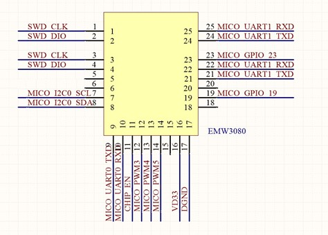

# 斐讯悟空 M1 空气检测仪 — ESPHome 固件（RTL8710B）

把斐讯「悟空 M1」空气检测仪的原厂 WiFi 模块（庆科 **EMW3080BE**，内部实为
Realtek **RTL8710BN**）刷成 **ESPHome** 固件，绕过斐讯已死的云端，纯本地接入
Home Assistant。

固件通过 UART 协议与主控 **SAMD20G18A** 通信：读取甲醛 / 温湿度 / PM2.5，
并控制数码管屏幕的亮度、开关与时钟。传感器和屏幕仍然由原厂主控驱动，本固件
只替换 WiFi 协处理器，不动 SAMD20，因此**所有原厂硬件功能完好**。

## 特性

- **纯本地接入**：ESPHome API + 原生 OTA，不依赖任何云端。
- **完整传感器数据**：甲醛（mg/m³）、温度（°C）、湿度（%RH）、PM2.5（µg/m³），
  来自 SAMD20 的 0x01 上报帧。
- **屏幕控制**：亮度（0 / 25 / 50 / 75 / 100）、开关、时钟设置（0x02 / 0x03 命令），
  重启后自动恢复上次状态。
- **状态灯**：WiFi 图标灯（PA5）+ 红叉灯（PA12），支持「指示灯总开关」，夜间可全灭。
- **查询间隔可调**：Home Assistant 里可动态调整传感器轮询频率。
- **可扩展**：模块还有几个空闲引脚（PA0 / PA8 / PA19 / PA22），可外接红外发射、
  继电器、气体传感器等，详见 [`docs/M1_hardware_expansion.md`](docs/M1_hardware_expansion.md)。

## 文件结构

```
├── esphome-phicomm-m1.yaml      # ESPHome 配置（固件本体，含全部 UART 协议逻辑）
├── secrets.yaml.example        # WiFi 凭据模板（复制为 secrets.yaml 后填写）
├── .github/workflows/build.yml  # GitHub Actions：打 tag 自动编译并发布 Release
├── docs/
│   ├── M1_protocol_spec_details.md   # UART 协议文档（帧格式 / 引脚映射 / 时序）
│   ├── M1_hardware_expansion.md      # 硬件扩展指南（空闲引脚 / 外接传感器方案）
│   ├── emw3080_pin.jpg               # EMW3080 模块引脚图（刷机接线参考）
│   ├── mx1290_pin.png                 # MX1290 芯片 QFN-32 引脚图（A_D Electronics 拆解）
│   └── rtl8710bn_pin.png              # RTL8710BN 芯片 QFN-32 引脚图（同上）
├── tools/serial_dump.py        # 串口原始数据 hexdump 工具（抓 UART 协议用）
└── LICENSE                     # GPL-3.0
```

## 配置与编译

### 1. 配置 WiFi

复制凭据模板并填写：

```
cp secrets.yaml.example secrets.yaml
```

编辑 `secrets.yaml`：

```yaml
wifi_ssid: "你的WiFi名称"
wifi_password: "你的WiFi密码"
```

`secrets.yaml` 已被 `.gitignore` 忽略，不会误提交。

### 2. 编译固件

需要 Python 环境：

```
pip install esphome
esphome compile esphome-phicomm-m1.yaml
```

产物在 `.esphome/build/phicomm-m1/.pioenvs/phicomm-m1/`：

| 文件 | 是什么 | 本机用不用 |
|---|---|---|
| `firmware.bin` | **LibreTiny 生成的固件**。注意：它**不是**裸二进制，而是 **UF2 容器格式**（文件头 `UF2\n`，与 `firmware.uf2` 字节完全相同），每个块内嵌了目标 flash 地址（OTA1=0xB000、OTA2=0x80000）。`ltchiptool flash write` 会在 PC 端解析这些地址再写入。 | ✅ **刷这个** |
| `firmware.uf2` | 与 `firmware.bin` **内容完全一样**，只是扩展名不同。 | ✅ 刷它也一样（已实测可用） |

> **结论：本项目的 `firmware.bin` 和 `firmware.uf2` 是同一份文件**（都是 UF2 容器），
> 用 `ltchiptool flash write` 刷哪个**效果完全一样**，都能成功。README 刷机命令统一写
> `firmware.bin`，你习惯用 `.uf2` 也完全可以。
>
> 这与 ESP32 / ESP8266 不同（它们的 `.bin` 是裸固件、`.uf2` 才带地址包装）；LibreTiny
> 平台（rtl87xx）则统一用 UF2 打包固件，所以"UF2 引导程序 / U 盘拖拽烧录"的概念
> 在本项目不适用——无论 `.bin` 还是 `.uf2`，都是交给 ltchiptool 解析写入。

### 3. GitHub Actions 自动编译并发布 Release

仓库已带 `.github/workflows/build.yml`，打 tag（如 `v1.0.0`）或手动触发后自动完成：

1. **默认固件**（WiFi 为占位符 `your_wifi_ssid` / `your_wifi_password`）：
   **始终编译**并发布到 **GitHub Release**，供任何人公共下载。
   ✅ 默认固件**内置首次配置向导**：连不上占位 WiFi 时自动开启配置热点
   `Phicomm-M1-Setup`（密码 `12345678`），手机连接后用网页填入自家 WiFi 即保存联网，
   **完全不需要编译**（详见下文「默认固件免编译体验」）。
2. **个人固件**：如果在仓库 **Settings → Secrets and variables → Actions** 配置了
   `WIFI_SSID` 和 `WIFI_PASSWORD`，会**额外**编译一份带个人 WiFi 的固件，
   只上传到 Actions 运行记录的 **artifacts**（不发布到 Release，避免凭据公开），
   仓库所有者可直接下载刷入。

操作方式：

- 推送 tag：`git tag v1.0.0 && git push origin v1.0.0`；
- 或到仓库 **Actions** 页手动运行（`workflow_dispatch`）。

Release 里的下载文件：

| 文件 | 说明 |
|---|---|
| `phicomm-m1.bin` | 串口刷机用（默认固件，占位 WiFi，带首次配置向导） |
| `phicomm-m1.uf2` | 与 `.bin` **内容完全相同**（LibreTiny UF2 容器），二选一即可 |

### 4. 默认固件免编译体验（首次配置向导）

不会编译的用户直接刷 Release 里的 **默认固件**（`phicomm-m1.bin` / `.uf2`），
刷入后按下面 5 步，手机就能把 WiFi 配进去，之后正常联网使用：

1. 刷入默认固件并开机，**等待 1–2 分钟**（占位 WiFi 连接失败后自动开启配置热点）；
2. 手机打开 Wi-Fi，连接热点 **`Phicomm-M1-Setup`**（密码 **`12345678`**）；
3. 连接后**会自动弹出配置页面**（若未弹出，用手机浏览器打开 `http://192.168.4.1`）；
4. 选择你家 Wi-Fi 并输入密码，点保存；
5. 设备自动保存凭据并重启，几秒后连上你家 WiFi，配置热点自动关闭，配置完成。

之后即可在 Home Assistant 里通过 **ESPHome 集成**发现设备（或直接用浏览器访问
设备 IP 打开网页控制台，可调屏幕亮度 / 开关 / 查询间隔）。

> ⚠️ 说明：
> - 配置好的 WiFi 凭据保存在设备 Flash 中；**长按前面板按键触发恢复出厂会清空它**，
>   之后配置热点会再次出现，可重新配置。
> - 若不配置，设备会循环：开配置热点 **5 分钟** → 关闭重试主 WiFi → 再开热点，
>   随时都可以按上面步骤连接配置。
> - 想跳过向导直接固定 WiFi？按上文第 1、2 步本地编译个人固件即可。

## 刷机

### 1. 接线

M1 的 TTL 刷机口就是模块的日志/下载 UART（模块 **24 / 25** 脚 = PA30 / PA29）。
拆机后在主板上找到 WiFi 模块，参考下图接线：



| USB-TTL | 模块引脚 | 说明 |
|---|---|---|
| 3.3V | 16（VDD33） | 给模块单独供电（可选，见下） |
| GND | 17（GND） | 必须共地 |
| RX | 24（PA30） | 模块 TX → TTL RX（日志/下载口） |
| TX | 25（PA29） | TTL TX → 模块 RX（日志/下载口） |

> - **推荐模块单独供电**：M1 整机断电，用 USB-TTL 的 3.3V 输出接模块 16 脚供电，
>   避免整机 5V 电源与 TTL 电平打架。
> - 也可以整机原电源供电（此时不接 VCC，只接 GND / TX / RX），
>   但**必须确认 USB-TTL 是 3.3V 电平**（不是 5V 的板子）。
> - 模块 24 / 25 脚与 21 / 22 脚为同信号双焊盘（21≡24、22≡25），我用杜邦线直接插入25 25脚的圆孔中可以成功。
> - 之前刷过猪头大佬或者zM1大佬固件的可能用的是[这种接线方式](https://github.com/a2633063/zM1/wiki/%E5%9B%BA%E4%BB%B6%E7%83%A7%E5%BD%95)，
>   那个接线方式中TTL的RX TX接第9 10引脚，但我实测用ltchiptool这样接线刷不了，jlink那种方式我没试过。

### 2. 备份原厂固件（强烈建议）

刷机前先用 `ltchiptool` 把整片 flash 读出来备份，之后可以刷回：

```
ltchiptool flash read -d COM3 RTL8710B m1_stock_backup.bin
```

- `ltchiptool` 是 LibreTiny 官方烧录工具。安装 PlatformIO + LibreTiny 后自带：
  `~/.platformio/penv/.libretiny/Scripts/ltchiptool.exe`（Windows），
  也可以 `pip install ltchiptool` 单独安装。
- 命令末尾的 `RTL8710B` 是芯片 family 名（等价于 `realtek-ambz`）。
- 备份文件大小应等于 flash 总容量（本机 2MB，即 2097152 字节），偏小说明有问题。

### 3. 刷入 ESPHome 固件

```
ltchiptool flash write -d COM3 firmware.bin
```

`ltchiptool` 会自动识别固件格式并写入正确地址（0x0）。刷完重新上电，
日志口（PA30，模块 24 脚）会以 **115200 8N1** 输出 ESPHome 日志，可确认启动状态。

### 4. 刷机注意事项

- **USB-TTL 时好时坏是常见现象**：模块下载口对信号质量敏感，接触不良 / 杜邦线过长 /
  电平不匹配都会导致连接失败。建议：
  - 优先用 CH343 芯片的 3.3V 电平 USB-TTL，线越短越好；
  - 失败就重新插拔 USB、重新给模块上电再试（ltchiptool 会自动进入下载模式）；
  - 多次失败时检查 GND 是否可靠、模块 16 脚供电是否稳定。
- **刷回原厂**：用第 2 步的备份文件：
  ```
  ltchiptool flash write -d COM3 -f RTL8710B -s 0x0 m1_stock_backup.bin
  ```
  整片 raw dump 没有文件头，必须手动指定 `-f RTL8710B -s 0x0`。
- 刷机不影响 SAMD20 主控；如果以后不想用了，刷回备份即可完全还原。

## 相关文档

- **[UART 协议文档](docs/M1_protocol_spec_details.md)**：帧格式（0x23/0x21 定界）、
  命令字、引脚映射、启动时序、恢复出厂等，以及 `tools/serial_dump.py`
  的抓包方法。
- **[硬件扩展指南](docs/M1_hardware_expansion.md)**：哪些引脚空闲、怎么加红外 /
  继电器 / 第二路串口传感器。
- 图片来源：`emw3080_pin.jpg` 为模块实物引脚标注；
  `mx1290_pin.png` / `rtl8710bn_pin.png` 来自 A_D Electronics 对 EMW3080 的拆解
  （证实内部为 MX1290 = RTL8710BN），引脚映射依据见协议文档 §3.1。

## 免责声明

- 刷机有风险，操作前请备份原厂固件；本固件与本文档仅供学习研究，请自行承担后果。
- 固件中的 UART 协议为社区分析成果，可能不完整，请以实测为准。