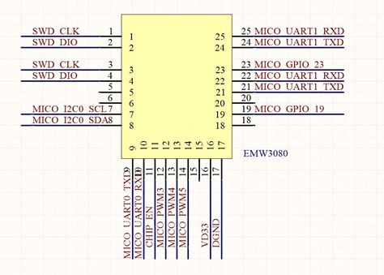

# 斐讯悟空 M1 空气检测仪 — ESPHome 固件（RTL8710B）

## 这是什么？为什么要刷它？

**斐讯悟空 M1** 是斐讯当年出品的一款桌面空气质量检测仪：一个带大数码管屏幕的
小方盒子，能同时显示 **PM2.5、甲醛、温度、湿度**，适合放在家里随时了解
空气质量。

问题在于：**斐讯的云端服务已经停止**，原厂 App 连不上服务器，设备沦为
"只会亮屏"的摆设。本项目把它的 WiFi 模块刷成 **ESPHome** 固件，让设备：

- **完全本地化**：数据不再经过任何厂商云端；
- **接入 Home Assistant**：在手机/电脑上实时查看甲醛、PM2.5、温湿度；
- **远程控制**：开关屏幕、调亮度、校时，原厂硬件功能全部保留。

刷机只需一根 USB-TTL 线，按下文「刷机」章节操作即可；不会编译的用户也可以
直接刷仓库 Release 里的默认固件，用手机热点配网（见「默认固件免编译体验」）。

---

## 技术简介

把斐讯「悟空 M1」空气检测仪的原厂 WiFi 模块（庆科 **EMW3080BE**，内部实为
Realtek **RTL8710BN**）刷成 **ESPHome** 固件，绕过斐讯已死的云端，纯本地接入
Home Assistant。

固件通过 UART 协议与主控 **SAMD20G18A** 通信：读取甲醛 / 温湿度 / PM2.5，
并控制数码管屏幕的亮度、开关与时钟。传感器和屏幕仍然由原厂主控驱动，本固件
只替换 WiFi 协处理器，不动 SAMD20，因此**所有原厂硬件功能完好**。

## 特性

- **纯本地接入**：ESPHome API + 原生 OTA，不依赖任何云端。
- **完整传感器数据**：甲醛（mg/m³）、温度（°C）、湿度（%RH）、PM2.5（µg/m³），
  来自 SAMD20 的 0x01 上报帧。支持**负温度**（帧 `[4]` 符号位）。
- **数据可信度**：帧内三个健康标志（PM / 甲醛 / 温湿度）+ 15 秒新鲜度判定。
  传感器未就绪或链路中断时，实体置为不可用，不再显示过期的旧读数。
- **蜂鸣器**：单次鸣叫按钮（0.5s）+ 告警循环（响 300ms / 停 1.7s，最长 60s 自动停），
  走原厂 `0x0e` 命令；重启和主控复位时自动补发停止帧，不会一直响。
- **屏幕控制**：亮度（0 / 25 / 50 / 75 / 100）、开关、时钟设置（0x02 / 0x03 命令），
  重启后自动恢复上次状态。
- **主控版本**：开机查询一次 `0x11`，在 HA 里显示原厂主控版本（如 `11.1.2.1`），
  方便判断设备状态与后续能力扩展。
- **状态灯**：WiFi 图标灯（PA5）+ 红叉灯（PA12），支持「指示灯总开关」，夜间可全灭。
- **查询间隔可调**：Home Assistant 里可动态调整传感器轮询频率。
- **可扩展**：模块还有几个空闲引脚（PA0 / PA8 / PA19 / PA22），可外接红外发射、
  继电器、气体传感器等，详见 [`docs/M1_hardware_expansion.md`](docs/M1_hardware_expansion.md)。

## 文件结构

```
├── esphome-phicomm-m1.yaml      # ESPHome 配置（固件本体，含全部 UART 协议逻辑）
├── secrets.yaml.example        # WiFi 凭据模板（复制为 secrets.yaml 后填写）
├── .github/workflows/build.yml  # GitHub Actions：每次 push 自动发布滚动 Release，打 tag 发稳定版
├── docs/
│   ├── M1_protocol_spec_details.md   # UART 协议文档（帧格式 / 引脚映射 / 时序）
│   ├── M1_hardware_expansion.md      # 硬件扩展指南（空闲引脚 / 外接传感器方案）
│   ├── M1_memory_optimization.md     # 内存问题分析与优化（RTL8710BN 堆紧张 / 崩溃排查）
│   ├── emw3080_pin.jpg               # EMW3080 模块引脚图（刷机接线参考）
│   ├── mx1290_pin.png                 # MX1290 芯片 QFN-32 引脚图（A_D Electronics 拆解）
│   └── rtl8710bn_pin.png              # RTL8710BN 芯片 QFN-32 引脚图（同上）
├── tools/serial_dump.py        # 串口原始数据 hexdump 工具（抓 UART 协议用）
└── LICENSE                     # GPL-3.0
```

## 配置与编译

### 1. 配置 WiFi

复制凭据模板并填写：

```
cp secrets.yaml.example secrets.yaml
```

编辑 `secrets.yaml`：

```yaml
wifi_ssid: "你的WiFi名称"
wifi_password: "你的WiFi密码"
```

`secrets.yaml` 已被 `.gitignore` 忽略，不会误提交。

### 2. 编译固件

需要 Python 环境：

```
pip install esphome
esphome compile esphome-phicomm-m1.yaml
```

产物在 `.esphome/build/phicomm-m1/.pioenvs/phicomm-m1/`：

| 文件 | 是什么 | 本机用不用 |
|---|---|---|
| `firmware.bin` | **LibreTiny 生成的固件**。注意：它**不是**裸二进制，而是 **UF2 容器格式**（文件头 `UF2\n`，与 `firmware.uf2` 字节完全相同），每个块内嵌了目标 flash 地址（OTA1=0xB000、OTA2=0x80000）。`ltchiptool flash write` 会在 PC 端解析这些地址再写入。 | ✅ **刷这个** |
| `firmware.uf2` | 与 `firmware.bin` **内容完全一样**，只是扩展名不同。 | ✅ 刷它也一样（已实测可用） |

> **结论：本项目的 `firmware.bin` 和 `firmware.uf2` 是同一份文件**（都是 UF2 容器），
> 用 `ltchiptool flash write` 刷哪个**效果完全一样**，都能成功。README 刷机命令统一写
> `firmware.bin`，你习惯用 `.uf2` 也完全可以。
>
> 这与 ESP32 / ESP8266 不同（它们的 `.bin` 是裸固件、`.uf2` 才带地址包装）；LibreTiny
> 平台（rtl87xx）则统一用 UF2 打包固件，所以"UF2 引导程序 / U 盘拖拽烧录"的概念
> 在本项目不适用——无论 `.bin` 还是 `.uf2`，都是交给 ltchiptool 解析写入。

### 3. GitHub Actions 自动编译并发布 Release

仓库已带 `.github/workflows/build.yml`，**每次 push 到 master 自动编译**并发布到
滚动 Release `latest`（**无需打 tag**）；打稳定版 tag（如 `v1.0.0`）或手动触发
（Actions 页 `workflow_dispatch`）同样会构建并发布：

1. **默认固件**（WiFi 为占位符 `your_wifi_ssid` / `your_wifi_password`）：
   **始终编译**并发布到 **GitHub Release**，供任何人公共下载。
   ✅ 默认固件**内置首次配置向导**：连不上占位 WiFi 时自动开启配置热点
   `phicomm-m1`，手机连接后用网页填入自家 WiFi 即保存联网，
   **完全不需要编译**（详见下文「默认固件免编译体验」）。
2. **个人固件**：如果在仓库 **Settings → Secrets and variables → Actions** 配置了
   `WIFI_SSID` 和 `WIFI_PASSWORD`，会**额外**编译一份带个人 WiFi 的固件，
   只上传到 Actions 运行记录的 **artifacts**（不发布到 Release，避免凭据公开），
   仓库所有者可直接下载刷入。

操作方式（任选其一）：

- 直接推送代码：`git push origin master` → 自动构建并更新 `latest` 滚动 Release；
- 推送稳定版 tag：`git tag v1.0.0 && git push origin v1.0.0` → 发布到 `v1.0.0` Release；
- 或到仓库 **Actions** 页手动运行（`workflow_dispatch`）。

Release 里的下载文件：

| 文件 | 说明 |
|---|---|
| `phicomm-m1.bin` | **唯一发布的固件文件**（默认固件，占位 WiFi，带首次配置向导） |

> `.uf2` 与 `.bin` 内容完全一致（LibreTiny UF2 容器），为避免混淆 Release **只发布
> `.bin`**。需要 `.uf2` 时可用 `ltchiptool uf2 --input phicomm-m1.bin --output phicomm-m1.uf2`
> 一行转换；也可在每次构建的 **Actions artifacts** 里直接下载 `.uf2`。

### 4. 默认固件免编译体验（首次配置向导）

不会编译的用户直接刷 Release 里的 **默认固件**（`phicomm-m1.bin`），
刷入后按下面 5 步，手机就能把 WiFi 配进去，之后正常联网使用：

1. 刷入默认固件并开机，**等待约 30 秒**（`ap_timeout` 为 30 秒：持续连不上占位
   WiFi 满 30 秒即自动开启配置热点）；
2. 手机打开 Wi-Fi，连接热点 **`phicomm-m1`**；
3. 连接后**会自动弹出配置页面**（若未弹出，用手机浏览器打开 `http://192.168.4.1`）；
4. 选择你家 Wi-Fi 并输入密码，点保存；
5. 设备自动保存凭据并重启，几秒后连上你家 WiFi，配置热点自动关闭，配置完成。

之后即可在 Home Assistant 里通过 **ESPHome 集成**发现设备（或直接用浏览器访问
设备 IP 打开网页控制台，可调屏幕亮度 / 开关 / 查询间隔）。

> ⚠️ 说明：
> - 配置好的 WiFi 凭据保存在设备 Flash 中；**长按前面板按键触发恢复出厂会清空它**，
>   之后配置热点会再次出现，可重新配置。
> - 想跳过向导直接固定 WiFi？按上文第 1、2 步本地编译个人固件即可。

## 刷机

### 1. 接线

M1 的 TTL 刷机口就是模块的日志/下载 UART（模块 **24 / 25** 脚 = PA30 / PA29）。
拆机后在主板上找到 WiFi 模块，参考下图接线：



| USB-TTL | 模块引脚 | 说明 |
|---|---|---|
| 3.3V | 16（VDD33） | 给模块单独供电（可选，见下） |
| GND | 17（GND） | 必须共地 |
| RX | 24（PA30） | 模块 TX → TTL RX（日志/下载口） |
| TX | 25（PA29） | TTL TX → 模块 RX（日志/下载口） |

> - **推荐模块单独供电**：M1 整机断电，用 USB-TTL 的 3.3V 输出接模块 16 脚供电，
>   避免整机 5V 电源与 TTL 电平打架。
> - 也可以整机原电源供电（此时不接 VCC，只接 GND / TX / RX），
>   但**必须确认 USB-TTL 是 3.3V 电平**（不是 5V 的板子）。
> - 模块 24 / 25 脚与 21 / 22 脚为同信号双焊盘（21≡24、22≡25），我用杜邦线直接插入25 25脚的圆孔中可以成功。
> - 之前刷过猪头大佬或者zM1大佬固件的可能用的是[另外的接线方式](https://github.com/a2633063/zM1/wiki/%E5%9B%BA%E4%BB%B6%E7%83%A7%E5%BD%95)，
>   那个接线方式中TTL的RX TX接第9 10引脚，注意和这里接24 25脚的接线方式不一样，我实测用ltchiptool通过TTL接9 10脚刷不了，一定要接24 25脚。另外那个连接中的jlink那种方式[有人试过也可以成功](https://github.com/gitercn/esphome-phicomm-m1/issues/1)。

### 1.1 进下载模式：短接 24 脚与 GND

如果 `ltchiptool` 一直连不上（提示同步失败 / 等待握手超时），说明模块没有进入 ROM 的
UART 下载模式。可以手动强制进入：

```
断电 → 用跳线把 24 脚（PA30）短接 GND → 上电（插上 USB-TTL）→ 等 1~2 秒 → 移除短接
```

- **顺序不能反**：短接必须在**上电之前**建立，上电后 1~2 秒内撤掉；先上电再短接无效。
- 原理：PA30 是 RTL8710B ROM 的 `UART_DOWNLOAD` 判定脚，上电瞬间被拉低就进入下载模式，
  之后 `ltchiptool` 才能握手。撤掉短接后模块保持在下载模式，不会自己跳回运行。
- 只短接 **24 脚 ↔ GND（17 脚）**，不要把 3.3V（16 脚）和 GND 短在一起。

### 2. 备份原厂固件（强烈建议）

刷机前先用 `ltchiptool` 把整片 flash 读出来备份，之后可以刷回：

```
ltchiptool flash read -d COM3 RTL8710B m1_stock_backup.bin
```

- `ltchiptool` 是 LibreTiny 官方烧录工具。安装 PlatformIO + LibreTiny 后自带：
  `~/.platformio/penv/.libretiny/Scripts/ltchiptool.exe`（Windows），
  也可以 `pip install ltchiptool` 单独安装。
- 命令末尾的 `RTL8710B` 是芯片 family 名（等价于 `realtek-ambz`）。
- 备份文件大小应等于 flash 总容量（本机 2MB，即 2097152 字节），偏小说明有问题。

### 3. 刷入 ESPHome 固件

```
ltchiptool flash write -d COM3 firmware.bin
```

`ltchiptool` 会自动识别固件格式并写入正确地址（0x0）。刷完重新上电，
日志口（PA30，模块 24 脚）会以 **115200 8N1** 输出 ESPHome 日志，可确认启动状态。

### 4. 刷机注意事项

- **USB-TTL 时好时坏是常见现象**：模块下载口对信号质量敏感，接触不良 / 杜邦线过长 /
  电平不匹配都会导致连接失败。建议：
  - 优先用 CH343 芯片的 3.3V 电平 USB-TTL，线越短越好，用质量好的铜芯的硅胶杜邦线，不要用淘宝上最便宜那种；
  - 失败就重新插拔 USB、重新给模块上电再试（ltchiptool 会自动进入下载模式）；
  - 多次失败时检查 GND 是否可靠、模块 16 脚供电是否稳定。
- **刷回原厂**：用第 2 步的备份文件：
  ```
  ltchiptool flash write -d COM3 -f RTL8710B -s 0x0 m1_stock_backup.bin
  ```
  整片 raw dump 没有文件头，必须手动指定 `-f RTL8710B -s 0x0`。
- 刷 WiFi 模块**不影响 SAMD20 主控**；如果以后不想用了，刷回备份即可完全还原。

### 5. 刷开源主控固件（SAMD20）—— ⚠️ 本项目未实测

> 以下整理自 [phicomm_m1_mcu_atsamd20](https://github.com/phicomm-io/phicomm_m1_mcu_atsamd20)
> 的文档，**尚未在实机走过这条路径**，仅作为将来测试的备忘。主控刷错会变砖，只能靠 SWD 救。

M1 是双芯片：主控 ATSAMD20G18A 负责传感器/屏幕/蜂鸣器，WiFi 模块只做联网。
**刷 WiFi 模块不会碰主控**，反之亦然。换主控固件有两条路：

#### 路线 A：走 WiFi 模块的网络 OTA（不用拆机，但 ESPHome 做不到）

主控升级由 WiFi 模块通过 UART 的 `0x12`–`0x16` 完成：`0x12` 报块数/尾长，`0x13` 发数据块，
`0x14` 逐块应答，`0x15` 结束，`0x16` 提交后主控复位并搬运。

- **只有 iotcloud 联网固件实现了这套流程**（网页「固件升级」里选主控镜像）。
- **本项目的 ESPHome 固件没有实现**，所以刷了 ESPHome 之后无法再用网络给主控升级。
- 想走这条路：刷回 iotcloud 固件 → 升级主控 → 再刷 ESPHome。

#### 路线 B：SWD 拆机刷（通用，但可能被安全位挡住）

| 信号 | SAMD20 引脚 | 说明 |
|---|---|---|
| SWCLK | PA30 | 数据手册引脚，需在 PCB 上追线找测试点 |
| SWDIO | PA31 | 同上 |
| GND / 3V3 | — | 共地，3.3V 供电（**不要用 5V**） |

> ⚠️ 别和上一节搞混：这里的 **PA30 是 SAMD20 的引脚**，和 WiFi 模块 24 脚（也叫 PA30）
> 是**两颗不同芯片**的同名引脚，用途也完全不同（一个是 SWD 时钟，一个是下载模式判定脚）。

- 工具：J-Link / Atmel-ICE / DAPLink 均可（SAMD20 是标准 Cortex-M0+ SWD 接口）。
  注意：社区里"J-Link 刷 M1"的记录说的是刷 **WiFi 模块（RTL8710B）**，不是主控；
  **SAMD20 的 SWD 刷写本项目没有实测过**。
- **先读再写**：出厂若熔断了安全位（Security Bit），SWD 会直接拒绝连接，此时只剩
  整片擦除（Chip Erase），**原厂固件会永久丢失**。务必先尝试读整片 256KB 并核对大小，
  确认能读再动手。
- 刷写地址：应用 `0x4000`，Boot `0x0`，两个镜像不能互换。

#### 刷了开源主控之后，ESPHome 侧会有什么变化

`0x01` / `0x02` / `0x03` / `0x0e` / `0x11` 这些普通命令保持兼容，传感器和屏幕照常工作，
但有三点要注意：

1. **长按恢复出厂会失效**：开源主控改用 `0x72` 事务请求重置，不再发 `0x18`，
   本项目里监听 `0x18` 清配置的逻辑不会被触发。
2. **健康标志变准**：开源主控在 3 次失败 / 6 秒后真正清零（原厂是锁存），
   「数据可信度」那套门控会比现在灵敏。
3. **`0x19` 原始甲醛、`0x70` 扩展（PM1.0/PM10、颗粒计数、屏幕调试）可用**，
   但本项目没有实现这些命令，需要自己往 YAML 里加。

## 维护与改装

### PM2.5 传感器风扇保养（异响 / 读数一直为 0）

M1 的 PM2.5 用攀藤 **PMS7003M**（帧布局与 Plantower 兼容，具体型号以板上丝印为准），
内部有一个小风扇把空气吸进激光散射腔。用久了轴承缺油会异响，但**加润滑脂是有风险的
——加多了比不加更糟**，而且症状很像"传感器坏了"。

#### 拆卸与加脂

1. 小心拆开机器外壳（用吸盘沿缝隙慢慢撬开，不要硬掰）；
2. 找到 PM2.5 传感器模块，风扇可以**无损拆下**；
3. 用镊子小心取出风扇的**扇叶**；
4. 在风扇轴（转轴）上**加一点点润滑脂**——不要太稠，推荐稀一点的；
5. **注意用量**：只需很少即可，加太多反而会让风扇转不动，太稠的脂也会拖慢转速；
6. 装回之前**先通电试**：确认扇叶能正常转动、PM2.5 能正常读数，再装回外壳。

#### 加脂过量会出现的三种症状

| 症状 | 现象 |
|---|---|
| 转不动 | 风扇完全不转或明显变慢，PM2.5 一直是 0 |
| 加热能好一阵 | 吹风机加热后插电能出数据，运行一段时间又回到 0 |
| 时好时坏 | 第一次插电是 0，断电再插一次可能就正常了 |

#### 为什么读数会变成 0，而不是报错

1. **0 是"真实"的 0**。激光散射靠气流把颗粒送过光路计数：气流慢了，单位时间通过的颗粒
   就少，腔体里"没有颗粒"和"颗粒没被送进来"在光路层面几乎无法区分，传感器于是输出 0。
2. **润滑脂黏度对温度极其敏感**。加热后脂变稀、阻力下降 → 风扇转起来 → 有数据；温度回落，
   或者脂被离心甩到轴承一侧重新聚集 → 阻力回来 → 停转 → 又回到 0。
   "吹风机吹一下能好、过一会儿又不行"基本可以锁定是**加脂过量 / 脂太稠**，不是电子故障。
3. **主控只校验、不判断流量**。原厂主控收到 32 字节帧只检查帧头、长度、累加和与第 29 字节
   错误码，通过就把第 12–13 字节当作 PM2.5 显示。风扇"转得慢"通常不会让错误码置位
   （错误码主要反映激光/LED 一类电气故障），所以这个 0 会被当成合法测量值。
   **这就是屏幕上显示 0.00 而不是报错的原因。**

#### 已经加多了怎么办

- 拆下扇叶，用无绒布/棉签擦掉多余油脂；必要时用少量无水酒精清洁轴与轴孔，晾干后
  **重新上极少量**稀脂（宁可少，不够再补），判断风扇是否真的在转。
- 不要用 WD-40 之类的除锈润滑剂代替润滑脂——挥发后会更干、更卡。

#### 还有哪些没搞清楚

- 到底是"风扇转速不达标导致没有气流"，还是"PMS 内部固件自检失败后锁死输出"，
  现有信息不足以下结论。要区分两者，需要同时看**第 29 字节错误码**和**6 档颗粒计数**
  （>0.3 / 0.5 / 1 / 2.5 / 5 / 10 µm）：
  - 颗粒计数也全 0、错误码为 0 → 基本是气流/机械问题，与 PMS 固件无关；
  - 颗粒计数正常、只有质量浓度为 0 → 才更像换算或固件层面的问题。
- 原厂主控 + 本项目只能拿到**处理后的 PM2.5**，看不到错误码和颗粒计数。想拿原始帧，
  需要刷开源主控后用 `tools/m1_sensors.py --sensor pm` 读取（见 [phicomm_m1_mcu_atsamd20](https://github.com/phicomm-io/phicomm_m1_mcu_atsamd20)）。
- 想不拆传感器就抓数据：主控与 PMS 之间是 **9600 8N1** 的 UART（主控侧 TX=PA16、RX=PA17），
  用逻辑分析仪或 USB-TTL 直接抓这段总线上的 32 字节帧，比提取 PMS 内部固件省事得多。
- 真要分析 PMS7003M 的内部固件，需要先拆开传感器确认 MCU 型号、再想办法读取。

### 充电口 MicroUSB 改 Type-C

网上有玩家把 M1 底部的 MicroUSB 充电口改装成 **Type-C** 接口，正反可插，
配合现代充电线更方便。改装需要刮出电路板正极和管脚焊接处，Type-C 座子上需要焊上识别电阻，然后替换 MicroUSB 。

> ⚠️ 改装涉及焊接和打磨外壳，有损坏风险。

## 参考与致谢

UART 协议细节参考了两个开源项目：

| 项目 | 关系 | 本项目参考了什么 |
|---|---|---|
| [phicomm-io/phicomm_m1_mcu_atsamd20](https://github.com/phicomm-io/phicomm_m1_mcu_atsamd20) | 开源 **SAMD20 主控**固件（本项目目前还没试过刷主控） | `0x01` 帧字段（`[4]` 温度符号、`[11..13]` 健康标志及其锁存语义）、`0x0e` 蜂鸣器没有本地超时、`0x11` 版本应答格式、PM/甲醛/温湿度的采样节奏与错误码处理 |
| [phicomm-io/iotcloud-community-firmware](https://github.com/phicomm-io/iotcloud-community-firmware) | 开源**WiFi 模块**固件（与本项目同一颗芯片），基于庆科MiCO SDK | WiFi 侧的工程做法：`0x0d` 校时回读、蜂鸣器截止时间放在命令队列之外、15s 采样失效判定、指示灯 PWM 与状态机、健康标志的用法 |


## 相关文档

- **[UART 协议文档](docs/M1_protocol_spec_details.md)**：帧格式（0x23/0x21 定界）、
  命令字、引脚映射、启动时序、恢复出厂等，以及 `tools/serial_dump.py`
  的抓包方法。
- **[硬件扩展指南](docs/M1_hardware_expansion.md)**：哪些引脚空闲、怎么加红外 /
  继电器 / 第二路串口传感器。
- **[内存问题分析与优化](docs/M1_memory_optimization.md)**：RTL8710BN 内存紧张、
  fallback AP 连接设备时重启崩溃的原因与优化方案。
- 图片来源：`emw3080_pin.jpg` 为模块实物引脚标注；
  `mx1290_pin.png` / `rtl8710bn_pin.png` 来自 A_D Electronics 对 EMW3080 的拆解
  （证实内部为 MX1290 = RTL8710BN），引脚映射依据见协议文档 §3.1。

## 免责声明

- 刷机有风险，操作前请备份原厂固件；本固件与本文档仅供学习研究，请自行承担后果。
- 固件中的 UART 协议为社区分析成果，可能不完整，请以实测为准。